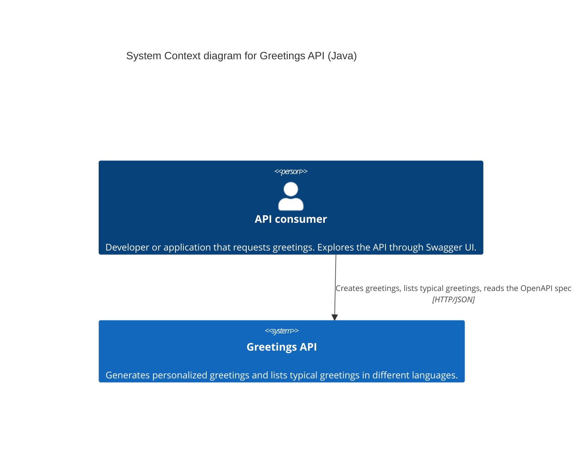
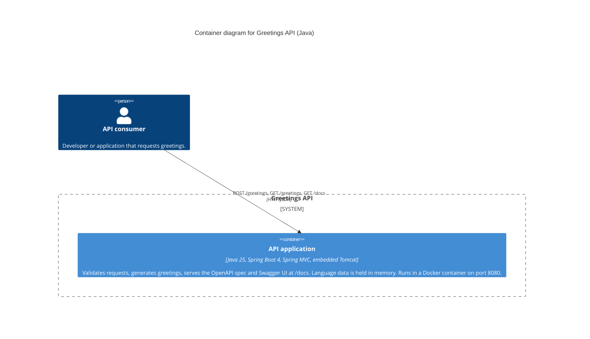
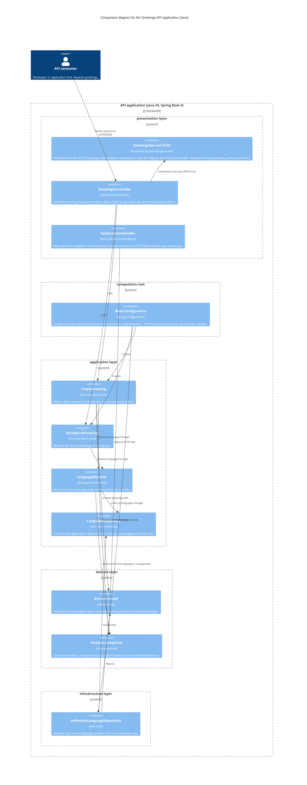
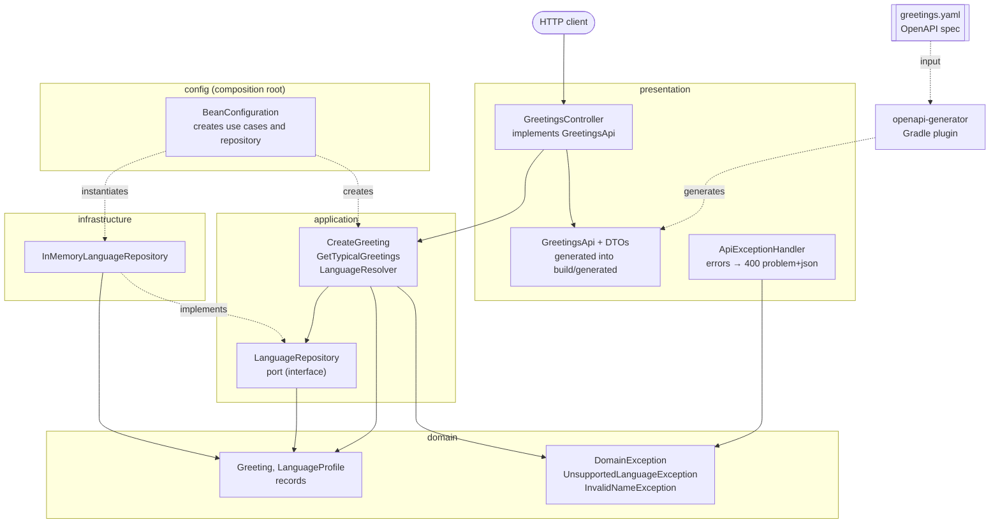
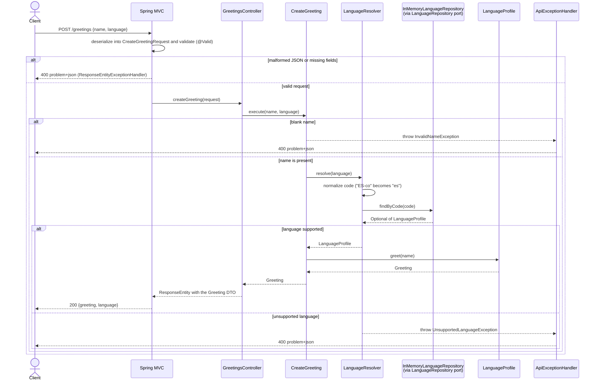

# Java implementation (Spring Boot)

Spec-first: the API interface and the request/response DTOs are generated from [`greetings.yaml`](../../greetings.yaml) at build time by the OpenAPI Generator Gradle plugin, so the spec is the source of truth. The layering is the same as in the Python version. The use cases are plain classes without Spring annotations, and `BeanConfiguration` is the composition root.

## Level 1: System context

Unlike the Python version, there is no external system: springdoc serves the Swagger UI assets from the application itself instead of loading them from a CDN.

## Level 2: Containers

## Level 3: Components

## Layers and dependencies

## Request flow: `POST /greetings`

`GET /greetings?lang=es` follows the same path through `GetTypicalGreetings`. It has no blank-name branch, and a missing `lang` is rejected by Spring MVC with a 400 before it reaches the controller.
