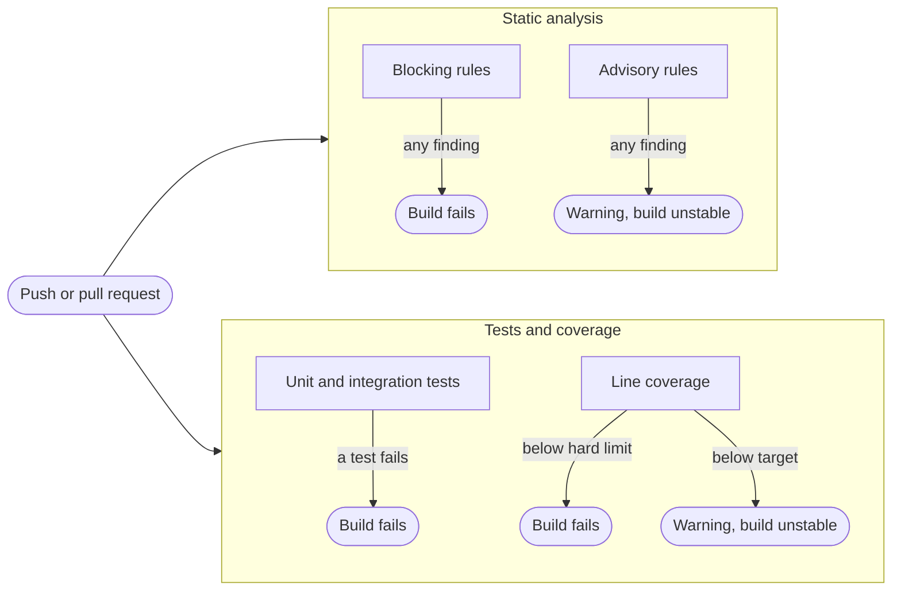

# CI/CD

Each project has a Jenkins pipeline and a GitHub Actions workflow that perform the same checks.

| | Python | Java |
|---|---|---|
| Jenkins | `.jenkins/python.Jenkinsfile` | `.jenkins/java.Jenkinsfile` |
| GitHub Actions | `.github/workflows/python.yml` | `.github/workflows/java.yml` |

## What a run does



Static analysis and tests run independently, so a lint failure does not hide the test results.

## Blocking and advisory checks

| | Python | Java |
|---|---|---|
| **Blocking** | Ruff rules `E,F,W,I,B,UP,S,C4,SIM`, `ruff format --check`, mypy `--strict` | Checkstyle `error` rules, PMD, SpotBugs |
| **Advisory** (reported, never fails the build) | A second Ruff run with `C90,PLR,ERA,T20,FIX` | Checkstyle `warning` rules: complexity, parameter count, return count, nesting, magic numbers, TODO comments |
| How the split works | Two Ruff runs, because Ruff has no severity levels | One Checkstyle run: severity is part of its configuration |
| In Jenkins | Advisory findings mark the build UNSTABLE (yellow) | Same |
| In GitHub Actions | Findings are rewritten as `::warning` annotations | Warning annotations from the Checkstyle report |

## Coverage

| | Python | Java |
|---|---|---|
| Hard limit (build fails below it) | `COVERAGE_MIN`, default 80 | `COVERAGE_MIN`, default 80 |
| Soft target (warning below it) | 85 | 90 |
| Enforced by | `pytest --cov-fail-under` | `jacocoTestCoverageVerification` |
| Metric | Line and branch coverage | Line coverage |

`COVERAGE_MIN` is a build parameter in Jenkins. In GitHub Actions it is a manual-run input that falls back to the `COVERAGE_MIN` repository variable, then to 80.

## Running the checks locally

```bash
# Python
cd python
uv run pytest
uv run ruff check app tests
uv run ruff format --check app tests
uv run mypy app

# Java
cd java
./gradlew check                       # tests, integration tests, static analysis, coverage gate
./gradlew check -PcoverageMin=85      # a different threshold
```

## Reports

| | Python | Java |
|---|---|---|
| Tests | `python/build/reports/tests.html`, `tests.json` | `java/build/reports/tests/test` and `tests/integrationTest` |
| Coverage | `python/build/reports/coverage/index.html`, `coverage.json` | `java/build/reports/jacoco/test/html/index.html` |
| Static analysis | Ruff and mypy output in the build log and Jenkins issue reports | `java/build/reports/checkstyle`, `pmd`, `spotbugs` |

Jenkins publishes the HTML reports as build pages, and GitHub Actions uploads the same folders as artifacts.

## Demo branches

`main` stays green. Each scenario lives on its own branch, never merged, so that the result of each one is unambiguous. Branch names are prefixed by language: `demo/python/...` and `demo/java/...`.

| Scenario | Expected result |
|---|---|
| Lint or style errors (unused import, hardcoded password, `eval`; in Java an unused import, string `==`, empty `catch`) | Blocking: the static analysis job fails |
| Type error (Python only) | Blocking: mypy fails |
| Coverage below the hard limit | Blocking: the test job fails |
| Code smells (complexity, many parameters, magic numbers, TODO) | Warning only: yellow in Jenkins, annotations in GitHub |
| Coverage between the limit and the target | Warning only |
