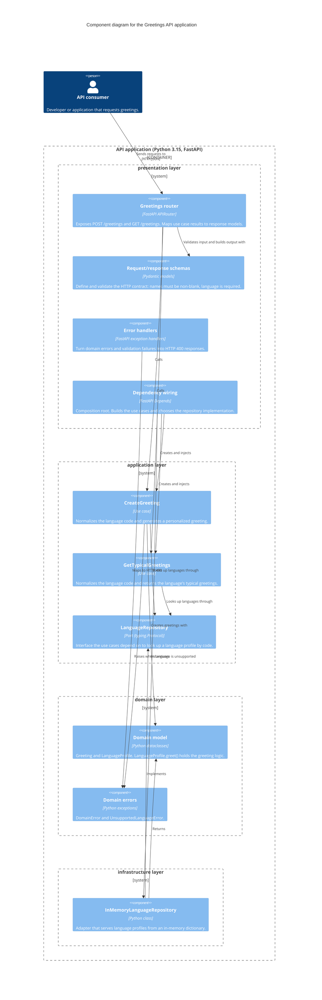
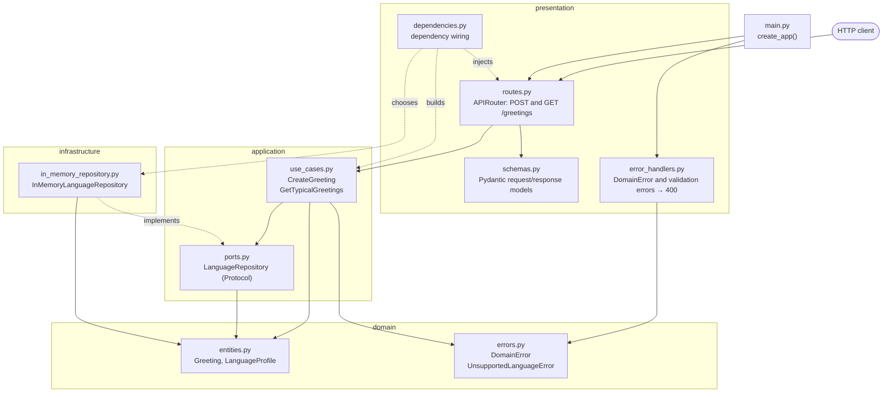
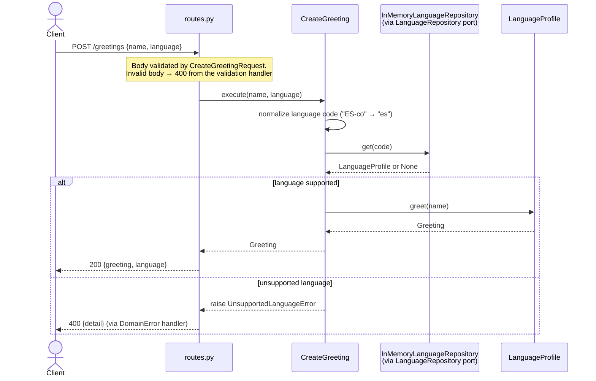

# FastAPI

Esta carpeta contiene la implementación del API definido en [`service-contract.yaml`](../service-contract.yaml). Puede ver el swagger de la aplicación en (http://localhost:8000/docs)

Para correr la aplicación usar:

```bash
uv run uvicorn app.main:app --reload
```

para correr las pruebas:

```bash
uv run pytest -v
```

## Arquitectura de la app

### C4 Level 3: Diagrama de componentes



### Capas y dependencias



### Flujo de un request: `POST /greetings`


